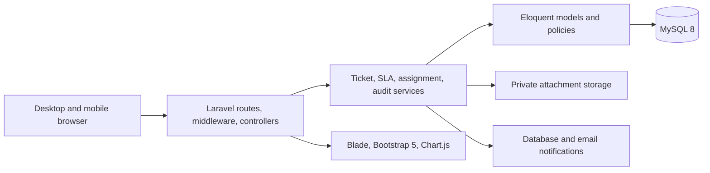
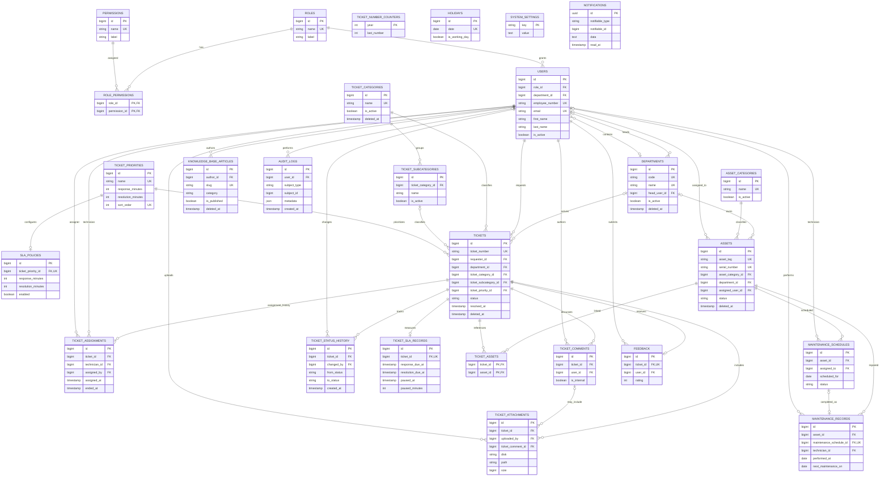

# UMIS-Helpdesk architecture and implementation plan

## Architecture

UMIS-Helpdesk is a Laravel 12 modular monolith backed by MySQL 8. Laravel MVC handles HTTP and rendering; Form Requests validate input; policies enforce record access; services own ticket numbering, state changes, assignments, SLA calculations, and audit writes. Blade and Bootstrap 5 provide server-rendered responsive screens, with small JavaScript enhancements. Laravel database notifications and private local storage are used initially; mail, queue, and cloud object storage remain environment-configurable for later deployment.

## Domain model

### Data design choices

The full table inventory and referential delete behavior are documented in [database.md](database.md).

* Roles are stored in a normalized `roles` table and referenced by users; role checks are centralized in policies/middleware. Permissions can be added without changing ticket records.
* Tickets keep requester/department/category/priority/status references and immutable ticket numbers. Assignment, status, comments, attachments, and SLA events are separate history tables.
* Composite foreign keys prevent a ticket from referencing a subcategory from another category and prevent feedback from being attributed to a non-requester.
* Ticket numbers use a per-year counter row locked in a database transaction, backed by a unique constraint (`MIS-YYYY-00001`).
* Historical ticket records are retained. User/category/department/asset deactivation is preferred to destructive deletion. Attachments are stored on a non-public disk and downloaded through authorized routes.
* Audit events are append-only through application code. Database access controls and backups remain part of deployment operations.
* Business-hour SLA arithmetic is a dedicated service that reads configurable working windows and holidays; calendar-time subtraction is not used as a substitute.
* `notifications.notifiable_*` and `audit_logs.subject_*` are polymorphic references and therefore have no conventional single-table foreign key. Database notification ownership is guarded by Laravel's notification relation and application authorization.
* The ticket number column allows 32 characters so the configurable ten-character prefix plus year and sequence fit. A per-year counter is the authoritative sequence source.

## Module boundaries

| Area | Main records | Application responsibilities |
|---|---|---|
| Identity and access | users, roles, permissions | Authentication, role assignment, account status, policies |
| Organization | departments | Department CRUD, department membership |
| Service desk | tickets, categories, priorities | Submission, triage, assignment, status history |
| Collaboration | comments, attachments, notifications | Public replies, staff-only notes, secure downloads |
| Service levels | policies, ticket SLA records, holidays | Business calendar and escalation tracking |
| Inventory | assets, categories, ticket-asset links | Asset CRUD, ticket association, repair history |
| Operations | maintenance schedules/records | Scheduling, assignment, completion records |
| Self service | knowledge articles, feedback | Searchable published guidance and satisfaction |
| Governance | audit logs, settings | Traceability, configuration, exports |
| Reporting | filtered queries | Database-backed reports and export adapters |

## Delivery checklist

### Phase 1 — foundation

- [x] Laravel project and environment setup
- [x] Authentication, server-side role authorization, account status
- [x] Role/permission administration with server-side permission middleware
- [x] Relational schema and seeded system roles/categories
- [x] Eloquent models and relationships, factories, database constraints, and full ERD
- [x] Department administration
- [x] User create/update/deactivate/reactivate and account activity view
- [x] Audit trail foundations
- [x] Token-based password reset email flow with generic responses, throttling, and audit events
- [x] Validated CSV user import (500-row cap, row validation, duplicate checks, reset emails)

### Phase 2 — ticket operations

- [x] Ticket submission and transactional ticket number generation
- [x] Assignment and reassignment history
- [x] Status history and resolution details
- [x] Conversations, internal notes, private attachments
- [x] In-app event notifications with retry deduplication and configurable email channel

### Phase 3 — service operations

- [x] Role-aware live dashboards, technician workload, department activity, overdue counts
- [x] Configurable business-hour SLA targets, working calendar, holidays, due dates
- [x] Filterable ticket report and CSV export
- [x] Scheduled SLA warnings/escalations, pending-user reminders, and configurable SLA pause workflow
- [x] Filtered ticket CSV, Excel, and PDF exports
- [x] Department/category/priority/technician/SLA/satisfaction and daily/weekly/monthly/annual ticket summaries
- [x] Filterable asset inventory and preventive maintenance reports with CSV, Excel, and PDF exports
- [x] Technician performance report with ticket counts and average elapsed response/resolution time

### Phase 4 — supporting modules

- [x] IT asset inventory CRUD and ticket links
- [x] Preventive maintenance scheduling, assignment and completion records
- [x] Knowledge base article search/publish and requester feedback
- [x] System settings and audit event recording
- [x] Read-only audit log review with actor, action, date, and user filters
- [x] Asset-linked ticket history, maintenance history, and asset-category management
- [ ] University logo upload and branding configuration

### Phase 5 — readiness

- [x] Automated functional/authorization/SLA tests
- [x] Setup, privacy, and UAT documentation
- [x] Local isolated MySQL-compatible backup/restore rehearsal
- [ ] Institutional backup schedule/encryption approval and UAT sign-off
- [ ] Visual review at desktop/tablet/mobile breakpoints
- [ ] Production security review and operational readiness

This checklist tracks actual implementation; unchecked items are not represented as completed functionality.

## Current test evidence and limits

The automated suite covers 60 feature/unit tests (351 assertions), including database relationships and constraints, ticket numbering and workflow, server authorization policies, user and department management, role-scoped dashboards, login rate limiting, private internal-note attachments, SLA timing and notification idempotency, assets and maintenance, filtered ticket/asset/maintenance reports, all CSV/Excel/PDF exports, feedback, and password/reset flows. The suite passed with the XAMPP PHP CLI against in-memory SQLite. Pint formatting, dependency advisory scan, local migration status, report route registration, and an isolated backup/restore rehearsal also passed. The migrations are applied to the local XAMPP MariaDB schema; `migrate:status` passed. `composer audit` found no known dependency advisories. A local backup/restore rehearsal restored a temporary dump into an isolated scratch schema, matched migration/user/ticket/asset/maintenance row counts, and removed its temporary artifacts. See [technical-test-report.md](technical-test-report.md) for exact commands, coverage, and limitations.

The configured local XAMPP database is MariaDB 10.4.32. MySQL 8 is the deployment target in `.env.example`, but a MySQL 8 run remains open. The test suite uses in-memory SQLite; run migrations, exports, and a restore test on MySQL 8 staging before organizational acceptance. Responsive Bootstrap layouts and small-screen CSS rules are present, but a visual breakpoint inspection was not completed because the available browser window could not be safely identified for local navigation.

## Local development defaults

Use the XAMPP bundled PHP 8.2 CLI, Composer, and MySQL 8. Local defaults are intended only for a developer machine. The university name, domains, working calendar, holidays, and mail transport must be supplied by the organization before production use. No real people or institution details are seeded.
